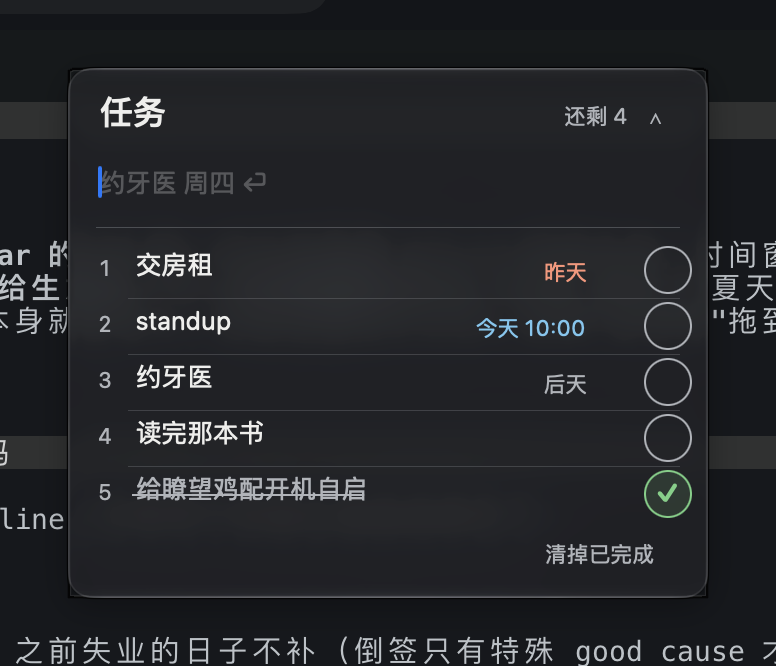

# 桌面清单 · Desk List

A task list that lives on the macOS desktop. Type a line, press Return.
Click the circle when it's done — the task doesn't disappear, it gets a
line drawn through it and stays.



南山（浅）/ 夜山（深）跟随系统。

## Why it finishes tasks instead of deleting them

Most lists treat "done" as "gone". That's efficient and it's also the
reason the list always looks like work you haven't done. A crossed-out
line is the only record that the day went anywhere.

So: finished tasks keep their number and their place. `清掉已完成` removes
them when you actually want them gone.

## What it does

| | |
|---|---|
| `⏎` | one line, one task |
| 今天 / 明天 / 周六 | one tap, while you are writing |
| `···` | a month, and a time |
| click a date | change it; `不限` removes it |
| paste several lines | several tasks, not one long one |
| click the circle | done — a line draws through the text |
| hover a row | `✕` to delete it |
| `∧` | collapse to the title bar |
| `⌃⌘L` | show / hide |
| drag anywhere | move it; it comes back there next launch |

Tasks are in `~/.local/share/desk-list/tasks.json` — plain JSON, yours to
read, edit, or sync. Nothing leaves the machine.

## Install

```sh
git clone https://github.com/daac-solo/desk-list
cd desk-list
python3 -m venv .venv
./.venv/bin/pip install -r requirements.txt
./.venv/bin/python desklist.py          # run it
./.venv/bin/python setup.py py2app      # or build Desk List.app
```

`⌃⌘L` needs Accessibility permission (System Settings → Privacy &
Security → Accessibility). Everything else works without it. Permission is
granted to a binary, so after rebuilding the app you may have to remove
and re-add it rather than just re-ticking the box.

## Time, three ways, none of them a form

Start writing and a row appears: **今天 · 明天 · 周六 · ···**. One tap sets
the date; `···` opens a month and a time. The row is only there while you
are writing — at rest this is a list, not a form, which is the whole
reason it can live on a desktop.

Or just type it: `约牙医 周四` and 周四 lifts out of the title into a chip. There is no
date picker because you already typed the time — asking you to then click
it is asking the same question twice. The guess shows up in the field
while you are still typing, so a parser that heard wrong is one you can
fix before you commit, not after.

Only the tail of the line is read: `周一的会议纪要` keeps its 周一, because
that one is part of the sentence. `check-when.py` has 36 cases and the
must-not-match group is as large as the must-match group — the dangerous
failure is not "did not understand", it is "understood something you
never wrote".

```sh
python3 check-when.py        # the parser and the offers, deterministic
python3 check-logic.py       # storage, splitting, every boundary
./.venv/bin/python smoke-input.py   # typing / ⌘V / focus, by hand
```

`check-logic.py` covers the half that can actually lose your work:
a corrupt file is moved aside rather than read as "you had no tasks", a
save that fails returns False instead of pretending, a file written by an
older version still opens, and a blank line never becomes a blank task.

`smoke-input.py` is a smoke script, not a gate: synthetic keystrokes race
AppKit's focus handling and the same build can score differently on
consecutive runs. It prints; you judge.

## Design

Colours, radius and the three type sizes come from
[`mac-desk-kit`](https://github.com/daac-solo/mac-desk-kit), which reads
one palette file shared across my tools. Three font sizes on a screen,
counted not estimated; contrast measured in both light and dark, never
eyeballed.

The one measurement worth repeating: the unfinished circle uses the
secondary text colour, not the divider colour. The divider token came out
at **1.42:1** against the glass, and this is the single thing on the
widget you are meant to click. A button too faint to see is the same as no
button.

## Not in here

No sync, no due dates, no projects, no notifications. Those are a
different app. This one is a sheet of paper you can't lose.

## License

MIT
